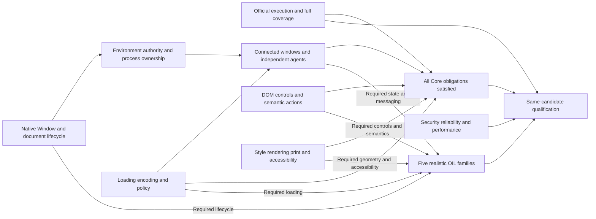

# Complete native Core conformance and five OIL workflow families

Plan date: September 15, 2026. Based on the completed September 15 diagnostic
WPT run and the current implementation/evidence records. This is an implementation
plan, not a claim that its work packages have been completed.

## 1. Recommended strategy

**Finish the existing native browser architecture in complete subsystems, while
runner coverage, rendering, and realistic workflow qualification proceed in
parallel.** Use one completion programme with two independently measured outcomes:
all Core obligations satisfied, and all five declared workflow families working
through OIL on the same production candidate.

The principal dependency chain is native document/Window lifecycle -> process
ownership and environment authority -> connected windows and independently
scheduled workers. A second potential critical path is official executor coverage
-> rendering, print and accessibility requirements. Loading, encoding, network
policy and platform algorithms have substantial independent work and start now.

Retain V8, the native DOM, generated bindings, HTML/XML parsers, Stylo and the
existing parent broker. Complete or replace a particular layout/rendering adapter
only when measured gaps justify it. A wholesale browser rewrite would discard
working foundations and delay evidence.

This plan interprets the goal as **native Oryn** completion. The existing Chromium
backend is a useful reference and a separate product option if immediate website
compatibility becomes the overriding goal. Its results cannot certify native Core
conformance or the native isolation/performance contract.

## 2. Fixed definition of completion

### Core

Use the official pinned WPT manifest and effective
[tier policy v2](../../benchmarks/conformance/wpt-capability-tiers-v2.json):

- WPT revision: `719d5e38fdd0903a18ed9007aba816c98cc491e0`.
- Manifest SHA-256: `566f2c77524c69cc249c5fe18507ad4c11866d9077b201681b19807c4ee28101`.
- Policy SHA-256: `a655bd38bbd3cc90e49344f7ceae1db1a3bfb09c8b84419b336ebf72f81eb84f`.
- **16,737 Core entries**, including every declared global and variant.
- All automatable entries execute validly and pass; manual/platform obligations
  have valid execution or explicit independent assessment. Any upstream-defect
  disposition must meet the existing source/assertion-bound review rules and
  preserve the raw result. Unsupported, blocked and unexplained outcomes remain
  open obligations.

Only already-reviewed pinned upstream-defect dispositions apply automatically.
New disagreements remain failing until separately reviewed and versioned; they
are not discretionary waivers for difficult implementations.

The [Core completion gates](WPT-CORE-COMPLETION-GATES.md) remain binding. Do not
change tier membership or the denominator in response to failures. Implement
Necessary/Extended capabilities when Core executions or the workflow contract
depend on them. Completing every unrelated tier is a separate goal.

### Five families

Complete the behavior matrix in section 6: research/extraction, forms/submission,
shopping, authenticated SaaS and booking/scheduling. Each needs genuine OIL
actions, realistic frontend behavior, independently verified final outcomes,
negative/recovery cases and concurrency/isolation checks.

Version and freeze that matrix before implementation acceptance. It is a concrete
product contract, not a promise of compatibility with every website. Keep all
existing immutable fixtures/tasks as regression inputs; additions get new corpus
versions. A framework boot or successful command is not a completed business task.

### Combined exit

Core, workflows, security, reliability and the existing performance gates all
pass on the **same frozen, signed, reproducible clean-source candidate**. Every
claimed platform and execution policy has its own evidence. The primary current
target is the signed macOS native runtime; Linux compilation alone does not
qualify Linux runtime behavior.

## 3. Starting point and what to preserve

The [September 15 full run](../../artifacts/wpt-full-baseline/full-current-2026-09-15/REPORT.md)
completed 35,010 supported executions across all tiers in 4h 38m. Its Core subset:

| Core outcome | Entries |
| --- | ---: |
| Raw pass | 4,415 |
| Failure | 9,315 |
| Environment-blocked | 17 |
| Unsupported execution | 2,990 |
| Total Core obligations | 16,737 |

The mapped attempted pass rate is 32.2%; it is not qualified coverage. Raw passes
also require valid prerequisites and provenance. Of the 9,315 failures, 6,914
are classified assertion, 1,840 harness, 512 runtime and 49 outer timeout.
Those classifications locate symptoms; they do not establish causes.

### Existing foundations that should be extended

- Arena/document ownership, ordered attributes, adoption/template ownership,
  AgentRuntime, native retirement and callback-safe realm/document helpers.
- Native Window identity accessors and explicit frame/document associations.
- Root-binding credentials and protocol v10, bounded IPC and admission/drain.
  Per-document grants and multi-environment process ownership remain incomplete.
- Rooted form submission, owned POST bodies, native file state and independent
  persisted submission oracles; selected constraints and numeric APIs pass.
- Scoped research extraction, native import maps and all eight pinned framework
  applications' declared boot/action checks.
- The OAuth script-close/action-acknowledgement repair and truthful CLI errors.
  The remaining nine close-test failures do not reopen that repaired defect.
- Deadline phase diagnostics for IPC-write, IPC-response and worker execution.
  The original booking timeout is still unexplained; later success did not fix it.

Existing outcome coverage is **42 controlled cases**: research 6, forms 19,
shopping 7, persisted SaaS 4 and booking 6. Add five auth-mechanics cases and eight
framework applications. Three samples each would give **165 planned attempts**
for a unified starting regression batch. This has not all been qualified on one
candidate; persisted SaaS diagnostics in particular need a matching signed build.

### Exhaustive Core work allocation

These mutually exclusive root groups cover the entire Core denominator. They are
ownership buckets, not root-cause diagnoses. Cross-cutting dependencies belong in
the work ledger without counting the same manifest entry twice.

| Primary capability group | Pass | Fail | Blocked | Unsupported | Total | Primary packages |
| --- | ---: | ---: | ---: | ---: | ---: | --- |
| HTML loading, scripting, contexts and elements | 1,033 | 3,317 | 0 | 1,117 | 5,467 | R, L, S, V |
| DOM, XML and WebIDL | 458 | 363 | 0 | 112 | 933 | S, L |
| Encoding, URL and MIME | 45 | 1,417 | 0 | 40 | 1,502 | L |
| Network, streams and files | 556 | 1,549 | 17 | 508 | 2,630 | L, W |
| Policy, security and session state | 1,634 | 1,750 | 0 | 39 | 3,423 | L, P, W |
| Components, modules and messaging | 184 | 489 | 0 | 83 | 756 | S, L, W |
| Interaction and accessibility | 132 | 239 | 0 | 458 | 829 | S, V |
| Core CSS cascade, selectors and CSSOM | 373 | 191 | 0 | 633 | 1,197 | V |
| **Total** | **4,415** | **9,315** | **17** | **2,990** | **16,737** | |

For reproducibility, HTML uses the `html` root; DOM uses `dom`, `domparsing`,
`domxpath`, `xml`, `webidl`; encoding uses `encoding`, `encoding-detection`,
`url`, `mimesniff`; network uses `fetch`, `xhr`, `cors`, `websockets`, `FileAPI`,
`streams`; components use `custom-elements`, `shadow-dom`, `import-maps`,
`webmessaging`; interaction uses `selection`, `focus`, `inert`, `uievents`,
`input-events`, `accname`, `wai-aria`, `html-aam`; CSS uses Core-classified `css`
entries. Policy contains `content-security-policy`, `referrer-policy`,
`mixed-content`, `upgrade-insecure-requests`, `permissions-policy`,
`trusted-types`, `secure-contexts`, `x-frame-options`, `subresource-integrity`,
`cookies`, `webstorage`.

The first investigation priorities are broader than the previously selected
Window/forms slices. Encoding alone has 1,296 failures; observed signatures
include missing decoder interfaces, incorrect legacy-encoding results and memory
limit exits. Across Core, 365 runtime failures report the 512 MiB RSS limit,
concentrated in encoding. Reproduce and separate decoder behavior, harness setup
and allocation/retention before choosing fixes; these signatures are not diagnoses.

## 4. Complete implementation work packages

Each package includes implementation, migration of all production callers,
regression controls, deletion of superseded semantic routes and full affected
family validation. Small commits can implement a package; a small green slice
cannot close it.

### G — Valid execution and complete coverage

**Deliverable:** a repository-owned integration with pinned upstream wptrunner,
plus a reconciled evidence ledger for every Core obligation.

- Adapt existing evidence/qualification tools to the full manifest. Record each
  entry's owner, prerequisite, observed failure, confirmed cause when known,
  implementation change and acceptance evidence. Keep raw and qualified outcomes
  distinct. The old 4,022-test backlog is not the new denominator.
- Implement the general authenticated automation contract: window handles,
  navigation, synchronous/asynchronous script, input/actions, testdriver
  operations, screenshots and lifecycle/error observation. Use the upstream
  product/executor interface for the required Core executor operations. Full
  WebDriver/wdspec conformance is a separate scope; none of the current 629
  unsupported wdspec entries is Core. Do not serialize browser fixes behind that
  unrelated expansion.
- Serve official wrappers and MIME types through upstream fixtures, including
  HTTPS, aliases, cross-origin hosts, redirects, websocket/HTTP variants, helpers
  and test CA trust through explicit test configuration.
- Provision a host/VM topology with genuinely distinct local/public IP spaces for
  all 17 environment-blocked Core entries. Hostname aliases alone cannot satisfy
  these local-network-access tests. Assign this environment work immediately.
- Implement testharness, reftest and crashtest execution; add genuine print and
  visual execution and a documented manual/assistive-technology assessment path.
- Reject missing helpers/subtests, unsupported automation, failed reference
  readiness and malformed results. Validate this with deliberately failing tests
  and fault injection. A reference browser helps diagnose fixture prerequisites;
  Oryn renders both sides of its own reftests.
- Close reference-browser focus and TLS-trust prerequisites. The current reference
  bypass does not establish normal certificate validation. Qualify reusable
  prerequisite rules against source hashes, expected subtests and intentional
  resource failures; do not mass-approve raw passes. The current Core ledger has
  no qualified results: 11,015 review candidates and 2,715 unresolved mapped
  results, alongside the unsupported and blocked entries.
- Keep the current runner for historical reproduction until new-runner parity is
  established. Preserve old evidence; create a separately attributed baseline
  when executor semantics change.

The September 15 runner already uses direct upstream wptserve fixtures, signed
workers and native persistent transport. Reuse those valid components for
development and migration. Distinguish that implementation from older synthetic
profiles and rejected worker adapters; official integration must implement the
upstream executor contract rather than merely renaming a legacy runner.

| Currently unsupported Core type | Entries | Required route |
| --- | ---: | --- |
| Testharness | 893 | 581 generated globals and 312 document/wrapper entries |
| Reftest | 1,003 | Rendering/readiness/reference comparison, upstream fuzzy metadata |
| Crashtest | 330 | Valid load/execution/lifecycle and actual crash observation |
| Manual | 749 | Per-test automation where equivalent, otherwise independent assessment |
| Print reftest | 12 | Print layout/pagination and upstream comparison |
| Visual | 3 | Valid visual procedure and recorded assessment |

Generated-global gaps include 264 classic service-worker, 292 classic
shared-worker and 25 module variants (6 service, 11 shared, 8 dedicated workers).
The 312 document/wrapper entries include XML 179, XHTML 99, SVG 19,
`.worker.js` wrappers 14 and XHT 1. These require real browser support as well as dispatch.
In particular, worker support is already a Core dependency despite separate
worker roots often being tiered Necessary.

**Exit:** every Core entry has a valid execution/assessment path, all harness
canaries reject correctly, and no unknown setup failure is converted to a pass.

### R — Native browsing contexts, documents, navigation and task lifecycle

**Deliverable:** one correct native lifecycle for top-level windows, iframes and
popups, shared by page script, OIL and automation.

- Complete synchronous insertion-time initial about:blank realm, Document,
  inherited origin/base/policy and stable native WindowProxy creation for both
  parser and script insertion. Reuse the implemented scope-based helpers.
- Replace provisional/committed JavaScript proxy factories with native routing:
  self/frames/parent/top/opener, document/location, named/indexed access and
  cross-origin permitted operations. Internal operations must survive author
  replacement of public properties and prototypes.
- Implement initial-empty-document reuse and later navigation rebinding without
  reinstalling incompatible bindings or changing retained document identity.
- Unify navigation request ownership, target selection, supersession, redirects,
  commit, history, reload, srcdoc, fragment traversal and lifecycle events.
  Implement sandbox/noopener/COOP relationships at their specified boundaries.
- Complete close eligibility and beforeunload/pagehide/unload ordering. Preserve
  ordered script-close acknowledgement and explicit host cancellation.
- Finish per-agent task-source ordering, microtask/custom-element/observer
  checkpoints, parser pauses and resource/rendering opportunities. Correct work
  must advance without an unrelated later OIL command.
- Route callbacks by their relevant/incumbent/current realms and native receiver.
  Retire execution authority and tasks independently from GC reachability of old
  Documents. No DOM/broker registry borrow may span arbitrary author script.

**Owners:** native host/agent/executable-document modules; JS realm/scheduler and
Window/document/location bindings. **Depends on:** existing foundations;
coordinate the environment interface with P immediately.

**Interface gate that unblocks P:** native context identity, document lifetime,
callback ownership and navigation/retirement contracts are implemented and tested
under existing placement. P proceeds from this gate while R's remaining browser
algorithms continue. It does not wait for the full package exit below.

**Exit:** complete mapped and newly enabled frame/Window/navigation/lifecycle
families; nested callback/GC/retained-object/security controls; realistic framed
research and popup-auth workflows on the same candidate. This is joint acceptance
with the necessary P/G/W capabilities, not a prerequisite that blocks starting P.

### P — Process ownership, environment authority and connected placement

**Deliverable:** a process can safely host the environments required by browser
semantics, with accurate isolation and failure behavior.

- Make WorkerProcessSession the sole process/client/IPC-dispatch owner. Routed
  page handles must not independently read the same stream.
- Complete parent-authoritative context/group/agent/cluster placement and bounded
  environment registration. Issue per-document/environment grants and rotate them
  at navigation boundaries; public IDs alone are never credentials.
- Target every command, completion, cancellation and privileged operation to its
  authorized environment/generation. Finish admission/revocation/drain for
  concurrent navigation, close, reset and in-flight operations.
- Implement connected-window hosting, synchronous same-agent access and remote
  permitted operations. Enforce origins even for co-located realms; independent
  root groups remain separated.
- Bound process/group/environment counts; close retires the correct environment,
  process failure reaches exactly its hosted domain, and reset/recycling requires
  complete destruction of all surviving authority, realms and clients.
- Version wire contracts, tracing, metadata, build validators and signing evidence
  together. Root-binding v10 is an existing foundation, not the completed route
  model. Use the next appropriate protocol version for incompatible changes.

The opt-in related-window direction is already approved in the implementation
ledger. Remaining threat-model, quota and signed tests are engineering acceptance
gates; no repeat approval for that same direction is needed.

**Owners:** native runtime/worker/client/route/context-service/network IPC and
validators. **Dependencies:** R's stable lifecycle contract; implementation of
interfaces and dispatch can progress alongside R before placement activation.

**Exit:** forged/stale/cross-partition denial, callback deadlock, sibling close,
failure fan-out, navigation grant rotation and reset/churn tests; revised signed
isolation evidence under each supported placement policy.

### L — Loading, encoding, networking and web security policy

**Deliverable:** shared resource machinery with complete API-specific semantics,
usable by documents, frames, scripts and workers.

- Finish URL resolution/serialization, MIME sniffing/dispatch, HTML/XML encoding
  selection and incremental decoding, legacy encoders and TextDecoder/stream
  interfaces. Profile the encoding/RSS cluster and repair allocation or ownership
  problems under existing production limits.
- Complete classic/module script fetch, graph linking/evaluation, dynamic import,
  top-level-await dependencies, canonical module identity and error/load ordering.
  Finish dynamic import-map insertion/merging and positive SRI validation, retaining
  existing exact/prefix/scoped resolution and Nuxt fixes.
- Use a typed request contract for navigation, fetch, XHR, scripts, styles,
  fonts/images, frames and workers. Carry initiator, destination, credentials,
  partition, origin, referrer, body, redirect and cancellation state. Preserve
  distinct CORS and load-blocking rules for each consumer.
- Complete Fetch/XHR/WebSocket, request/response bodies, streams/backpressure,
  abort and error propagation. Share owned body/file mechanisms with submission.
- Close CSP, Trusted Types, referrer, mixed content, secure contexts, frame
  embedding, permissions policy and integrity obligations across all resource
  destinations and redirects. Web policy and parent privilege enforcement are
  separate controls and both must hold.

**Owners:** native loader/import maps/context services, network stack, JS platform
and encoding/URL/stream bindings. **Dependencies:** R/P interfaces for integration;
pure encoding, URL, request, policy and module components start independently.

**Exit:** full owned Core groups and all globals, decoder/stream boundary and
bounded-memory controls, eight framework gates and realistic application loading.
Do not attribute every import-map or policy failure to the loader before checking
its frame, helper and automation prerequisites.

### W — Independent workers, messaging and persistent state

**Deliverable:** real agent execution and correctly scoped communication/storage.

- Dedicated workers have independent execution/scheduling and busy-script
  termination; another context inside the blocked page isolate is insufficient.
- Complete shared-worker identity, connections/ports, partitioning and client
  lifetime; service-worker registration, install/activate/control/fetch/update,
  restart and browser-context-owned persistent authority.
- Finish structured clone/transfer, MessagePort delivery, BroadcastChannel,
  close/teardown ordering and shared-memory obligations where required. Existing
  MessageChannel work is retained. BroadcastChannel is a concrete prerequisite
  in the historical close-test failures.
- Close all Core cookies/storage obligations and their dependencies, plus
  IndexedDB/storage behaviors required by the family contract, with
  navigation/restart, credentials, origin/partition, transaction ordering and
  multi-client controls.
- Keep document-owned and browser-context-owned lifetimes distinct. Route every
  worker/storage operation through P's authority model.

**Owners:** agent/scheduler/process coordinator, messaging bindings and parent
storage services. **Dependencies:** R/P/L contracts; algorithms and fixtures can
be developed before integrated agent activation.

**Exit:** official Core worker variants execute through genuine lifecycle paths;
cross-client/partition/termination/persistence tests and affected family outcomes
pass. No synthetic ServiceWorker constructor stands in for registration.

### S — DOM, WebIDL, components, controls and OIL semantics

**Deliverable:** one authoritative platform algorithm for each observable state
transition, used consistently by JS, trusted input, semantic actions and WPT.

- Close generated WebIDL conversion/exposure/brand/descriptor/realm rules and
  enforce regeneration consistency. Finish DOM namespaces/tree mutation,
  collections, traversal, XPath/parsing, Range/Selection, adoption and mutation
  lifetime obligations, including faithful reproduction of historical Range
  crash/resource failures.
- Complete custom-element definition/upgrade/reaction/adoption and shadow/slot
  ownership across parser, DOM, styles and accessibility.
- Finish form entry construction, custom-element participation, legacy encoding,
  image coordinates, target/rel policy, callback reentrancy and cancellation.
  Preserve native file selection, body fidelity and parent file grants.
- Finish input/editing, focus, disabled/inert/validation behavior, keyboard/pointer
  activation, drag/drop and DataTransfer, selection, event order and default
  actions. Include clipboard integration where these contracts require it.
  HTML drag/drop alone has 180 current failures and needs an explicit algorithm
  owner. The passing constraint and numeric slices remain regression controls,
  not work to redo.
- Complete OIL target identity, stale-reference recovery, action errors,
  extraction scopes and observation freshness through dynamic mutation, navigation
  and frame replacement. Semantic actions call native primitives; application
  state is never mutated through a test-only JavaScript shortcut.

**Owners:** DOM, generated JS/named binding modules, native semantic/action paths
and canonical scanner source. **Dependencies:** R/L and V's state/geometry
contracts, with pure algorithms and binding work available independently.

**Exit:** full affected DOM/component/forms/interaction families; matching state
through script/input/OIL; persisted submission, extraction and recovery outcomes;
no duplicate production implementation or public internal privilege hook.

### V — Style, layout, paint, accessibility and print

**Deliverable:** native geometry, pixels, hit testing and semantic/accessible
projections agree on the same document and style state.

- Retain Stylo; finish namespace/document/state selectors, cascade/CSSOM,
  stylesheet ownership, shadow scope and mutation invalidation.
- Map actual Core visual tests to required algorithms immediately: inline/block
  layout, tables/floats, intrinsic sizing, flex/grid dependencies, writing modes,
  positioning, overflow/scrolling, transforms and fragmentation. Assess existing
  Taffy/Parley/Blitz integration against these requirements before choosing
  targeted adapter work or a bounded subsystem replacement.
- Complete required text shaping, fonts, replaced elements, SVG/paint,
  clipping/stacking and print pagination. Do not infer these from a screenshot API.
- Make CSSOM geometry, hit testing, focus visibility and OIL input use the same
  layout revision. Extend cache invalidation to every relevant input; retain the
  existing layout-input reuse improvement.
- Complete accessible-name/ARIA/tree projection and incremental updates, checked
  against independent full recomputation. Support required OS/assistive-technology
  procedures for manual entries.

**Owners:** layout/render/semantic modules and vendored adapters; G owns executor
and assessment validity. **Dependencies:** stable DOM/state contracts; renderer
gap analysis and direct supported tests start before R/P completion.

**Exit:** required reftests/print/visual/manual obligations and Core CSS/AX/input
families pass with real reference readiness, fonts and viewport settings; no
plausible-but-incorrect geometry substituted for missing algorithms.

### F — Realistic five-family applications and integrated outcome evidence

**Deliverable:** the section 6 contract, exercised through OIL with independent
outcome verification on realistic applications.

- Reuse the six existing family/auth runners, SQLite backends, sealed/reopened
  databases, artifact locks and validator negative controls. Add one orchestration
  and reporting layer rather than six new harnesses.
- Add versioned realistic frontends over those backends. Use a covering matrix
  for client rendering, SSR/hydration, routing/chunks, portals/custom controls,
  cross-origin frames, async persistence and client timezones. Keep all eight
  existing framework gates; avoid unnecessary duplication of five large apps for
  every framework.
- Verify whether the frozen September 15 candidate matches the intended runtime
  source and reuse it when it does; rebuild/sign only when the source differs.
  Run all existing cases together early, resolving the earlier persisted-SaaS
  source mismatch through a matching run. Do not wait for all Core to pass before
  exposing realistic application failures.
- Capture expected final facts, records, receipts, orders and reservations as
  oracle contracts; include exact action/authority history where required.
  Retain every planned failure, retry and cleanup result.

**Owners:** workflow fixtures/tasks/outcome scripts and framework corpus additions.
**Dependencies:** existing runtime for corpus development; the specific R/L/S/W/V
capabilities named by each behavior cell for acceptance. Unrelated print/manual
or worker obligations do not hold this family milestone; they still hold final
Core completion. **Exit:** every matrix cell has valid passing evidence and all
eight framework gates pass on the final candidate.

### Q — Reliability, performance, security and final qualification

**Deliverable:** a reproducible candidate that satisfies all completed packages
together under production constraints.

- Reuse deadline diagnostics to reproduce the booking failure under bounded mixed
  workload. Add deterministic lifecycle/IPC/I/O fault controls where the existing
  reproduction lacks precision. Retain the original failure; a green retry is
  not a fix, and a hypothesized shared WPT cause is not evidence.
- Verify delayed/stale responses, worker failure, cancellation, restart and retry
  cannot duplicate external writes or leak state. Failed workers are killed and
  reaped; cleanup is part of the result.
- Profile end-to-end actions and readiness on integrated candidates. Requalify
  existing targets: cold P50 <=250 ms, warm >=300 actions/s, binding P50 <=50 ms,
  worker RSS P50 <=64 MiB/P95 <=160 MiB, and the required 1/5/20-context and
  churn/no-failure samples. New placement also needs group/aggregate measurements.
  The historical 124–126 actions/s diagnostic is below the throughput target;
  current performance needs fresh measurement.
- Recommended workflow acceptance sampling: each deterministic case runs three
  times in serial and three times in mixed-family mode; recovery-sensitive cases
  additionally get 30 repeated attempts and fault-injection controls. Run the
  existing 1/5/20-context performance/isolation suite. Freeze these counts before
  collecting acceptance evidence; they are engineering samples, not a universal
  statistical reliability guarantee.
- Freeze a reproducible source snapshot without discarding current work; bind
  parent/worker/V8/bindings/ICU/snapshot/signature, adapter, fixtures and OIL tasks
  to exact identities. Run full Core and all five families on that artifact.
- Audit all expected IDs and assertions, manual assessments, source-bound
  dispositions, security controls, resource limits, results and cleanup.
  Any implementation change after freezing produces a new candidate and requires
  the affected checks plus final integrated acceptance again.

**Exit:** the completion gates in section 8; no required work left in an
unsupported, unexplained, source-mismatched or unqualified state.

## 5. Parallel delivery and dependency order

Assume four active engineering owners, with one also integrating/reviewing.
These are work lanes, not a fixed staffing estimate. Additional capacity helps
after interfaces are stable; multiple simultaneous edits to the same host or
binding dispatcher generally do not.

| Lane | Start immediately | Continue after shared contracts stabilize |
| --- | --- | --- |
| 1: Runtime and authority | R lifecycle/Window completion; P interface and route design | P process-session/placement integration; W agent execution |
| 2: Loading and state | L encoding/RSS, URL/MIME, modules, requests/policy | W messaging/storage/worker resource consumers; remaining L closure |
| 3: Platform and presentation | S DOM/control contracts; V rendering/print/AX gap map and native work | Complete S/V algorithms and whole-family visual/input acceptance |
| 4: Execution and product evidence | G official adapter/coverage and F realistic corpus/oracles | G all executor modes, F integrated qualification, Q candidate audit |

Give `host.rs`, `rust_executable.rs` and `v8_bindings.rs` one integration owner
each. Extract named domain modules when required to complete an algorithm, then
assign those modules independently. Avoid a preliminary cosmetic whole-tree
refactor. Use isolated work branches/checkouts without losing the current dirty
source; integrate source changes at tested contract boundaries.

### Programme milestones

1. **Complete executable contract:** reconcile all 16,737 entries; version the
   five-family matrix; run the unified existing corpus on a current signed build;
   expose representative unsupported/global/rendering cases; assign all gaps.
   Reuse the completed WPT baseline instead of rerunning it unchanged.
2. **Complete browser boundary:** R/P are integrated, connected contexts and
   independent work have correct ownership, loading/task completion is native,
   and the new automation transport exercises those same paths. This removes
   shared prerequisites across thousands of potential callers.
3. **Five-family functional completion:** all section 6 behaviors work with
   realistic frontends and persisted oracles, including negative/recovery cases.
   This milestone can arrive before Core completion and remains separately named.
4. **Whole-Core implementation completion:** every supported and previously
   unsupported obligation is executable/assessable, and all required engine
   algorithms pass. S/V/L/W continue in parallel; rendering is not postponed
   until the mapped testharness subset is green.
5. **Combined qualification:** Q verifies the complete candidate, including
   performance/isolation, reliability and every family. Only this milestone
   satisfies the combined goal.

Milestones 3 and 4 may finish in either order. The finish date is governed by the
longest remaining runtime/agent, platform/encoding, executor/rendering or workflow
path, plus final qualification. Current failure counts do not support an honest
calendar promise. Estimate complete packages after their first faithful baselines
and measured throughput; retain the full target when estimates change.

## 6. Required five-family behavior matrix

| Family | Complete behavior | Negative/recovery and independent acceptance |
| --- | --- | --- |
| Research/extraction | Search/follow/compare multiple pages; exact text/table/link facts with canonical URLs; pagination and async refresh; dynamic frontend; same/cross-origin and nested frame behavior | Empty/missing sources, redirects, stale references and navigation; exact extracted facts and server request sequence; no detached/foreign-document leakage |
| Forms/document submission | Multi-step native/custom controls; text/options/date/numeric inputs; async validation; submit/cancel; real authorized file upload and GET/POST/multipart delivery | Invalid/required/disabled controls, submitter overrides, cancelled/reentrant submission, navigation and retry; exact receipt fields/order/Unicode/body and uploaded byte hashes; no receipt on rejection; file/secret confinement |
| Shopping | Hydrated/CSR search/filter/compare/variants; persistent cart/quantities; route/reload; quote/review and controlled checkout; declared framed payment-style flow | Async stock/price changes, stale quote/recovery, duplicate/retry; exact persisted cart/order/total/inventory and one accepted mutation; controlled test orders |
| Authenticated SaaS | Authenticated SPA login/SSO; real authorization-code/PKCE exchange with a controlled cross-origin identity provider; MFA handoff/resume; create/read/update/reload/logout | State/redirect/verifier/replay/expiry checks, session expiry/relogin, stale/duplicate saves, denied unauthorized writes, context isolation and redaction; exact persisted record/version/authorization history and session state |
| Booking/scheduling | Client datepicker and timezone conversion; DST fold and gap; availability/options/review; controlled reservation and confirmation reload | Stale/unavailable slot, validation, cancellation/retry/duplicates; exact UTC instant/zone/options, slot ownership/request history and one durable reservation |

The SaaS identity provider validates the browser flow with actual token-exchange
semantics, using an established test identity provider/library; this does not
require a new production auth service or tests dependent on a production account. MFA
handoff is an explicit human/authorized-test boundary, not a bypass. Existing
server-side booking timezone conversion and static auth codes do not satisfy
those new matrix cells. Framework-created JavaScript File objects and local cart
increments remain compatibility probes; real uploads/orders use the persisted
family oracles.

## 7. Validation cadence that minimizes elapsed time

### During implementation

- Use a reproducer, positive and negative controls, and relevant native/generated
  tests for the mechanism being changed. Cluster by verified shared cause, not
  only first-error text or directory. Missing prerequisites can conceal failures.
- Run the entire affected WPT family and relevant OIL outcomes at package
  integration. Include passing controls; a shrinking failure count must not hide
  new regressions. Do not rebuild/sign and rerun all tiers after every accessor.
- Run broader Core on integrated milestones and the full all-tier diagnostic when
  changes or regression concerns justify it. Final acceptance always covers the
  entire required Core selection, including new executor types.

### Make the test system faster without changing evidence

Core consumed approximately 13.81 aggregate worker-hours in the latest all-tier
run; harness-classified failures consumed about 9.04 of those hours. Fixture
startup/teardown added approximately 4.21 aggregate hours. These are summed task
times, not a measured standalone Core wall time.

Prioritize repeated timeout/readiness failures and setup overhead. The controller
already supports Core-only selection and a persistent parent. Reuse fixture
infrastructure only after proving per-test server/stash/cookie/storage/context
reset and deliberate contamination controls; preserve fresh browser isolation.
Schedule independent work across workers/hosts based on measured CPU/RSS and
fixture capacity. Keep the current persistent-parent maximum of eight execution
slots; scale beyond it using independently isolated hosts/parents. Raising
concurrency or recycling state is not automatically faster or valid. Keep
timeouts and production budgets fixed while diagnosing.

For distributed runs, bind each shard to identical candidate/manifest/adapter
hashes and compatible platform configuration; reconcile every ID exactly once.
Retries remain separate attempts. Do not assemble a final pass result from the
best outcome across different candidates or execution profiles.

## 8. Final acceptance checklist

The programme is complete only when all of these are true:

1. **Coverage:** 16,737/16,737 Core entries reconciled; no missing/duplicate IDs,
   unimplemented executor obligations or unresolved environment prerequisites.
2. **Conformance:** all automatable Core requirements pass valid execution;
   applicable manual/visual/platform assessments and any independently reviewed
   upstream dispositions are complete and preserve raw outcomes.
3. **Architecture:** native initial realms/WindowProxy/navigation, environment
   grants, connected windows, independent agents and retirement are complete;
   duplicate/probe-dependent production paths are removed.
4. **Product:** every section 6 behavior and all eight framework gates pass OIL
   outcomes and independent oracles, with failures/retries retained.
5. **Reliability:** required repetitions, mixed concurrency and fault controls
   pass; the booking timeout and other unexplained crashes/timeouts are resolved
   or remain explicit completion blockers. Non-recurrence alone is insufficient.
6. **Security and performance:** applicable signed denial/authority/teardown,
   resource-limit, isolation and performance gates pass for the claimed policy
   and platform; no unmeasured profile substitution.
7. **Provenance:** all evidence belongs to the exact frozen candidate and locked
   inputs; clean reproducible source, candidate integrity and fixture cleanup
   are verified. Historical mixed-candidate successes are not combined.

Report progress using these independent measures: obligations with valid routes,
raw/qualified Core outcomes, confirmed mechanism closures, family behavior cells,
reliability/performance results and open critical-path dependencies. Do not reduce
progress to one percentage or the number of small patches completed.

## Evidence and implementation references

- [Current implementation status](IMPLEMENTATION_STATUS.md).
- [Core completion gates](WPT-CORE-COMPLETION-GATES.md).
- [Architecture and migration](BROWSER-ARCHITECTURE-AND-MIGRATION-2026-09-13.md),
  [reviewed implementation packages](BROWSER-IMPLEMENTATION-READINESS-2026-09-13.md)
  and [implementation ledger](BROWSER-IMPLEMENTATION-LEDGER-2026-09-13.md).
- [Routing threat model](BROKER-ROUTING-THREAT-MODEL-2026-09-13.md).
- [Five-family readiness](OIL-AGENTIC-READINESS-2026-09-14.md) and
  [framework corpus](../../benchmarks/app-compatibility/frameworks/README.md).
- [Pinned execution plan](../../artifacts/wpt-full-baseline/inventory-v3/plan.json),
  [manifest coverage](../../artifacts/wpt-full-baseline/inventory-v3/coverage.jsonl)
  and [current outcomes](../../artifacts/wpt-full-baseline/full-current-2026-09-15/cohort.json).
- [Original booking timeout](../../benchmarks/evidence/booking-timeout-investigation-2026-09-14.md)
  and [subsequent implemented phase diagnostics](../../benchmarks/evidence/worker-deadline-diagnostics-2026-09-14.json).

Earlier architecture documents remain useful design records. Their proposed
foundations and initial work order must be read against the later implementation
ledger/status; several are now implemented. This plan supersedes their immediate
execution order for the combined Core-plus-five-family objective, without
weakening their still-applicable completion and security requirements.
